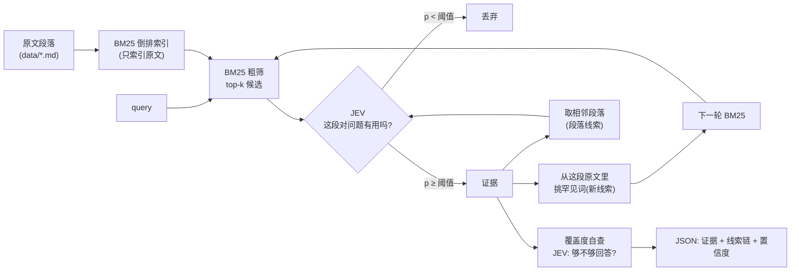

# mini_sag_wiki — 用 JEV 筛证据的关键词知识库

一个**专为 AI 调用**的检索 CLI：只对原文建 BM25 索引，用本地 JEV 判断「这段原文到底有没有用」，
再从被认可的原文里挑出新关键词继续搜，线索一路挂在关键词和段落上。

没有向量库、没有实体抽取、没有图谱、没有任何生成式调用——判断只有 yes/no 概率。



## 五个步骤分别落在哪个文件

| 步骤 | 实现 |
|---|---|
| 1. 只对原文建 BM25 索引 | `mini_sag_wiki/corpus.py`（切段）+ `mini_sag_wiki/bm25.py`（倒排、IDF、打分） |
| 2. BM25 先粗筛 | `Wiki.search()` / `pipeline.py` 的每轮 `index.search(frontier, k=pool)` |
| 3. JEV 判断哪些是有用证据 | `mini_sag_wiki/jev.py::judge_passage`（两句平均） |
| 4. 从证据里挑新关键词接着搜 | `pipeline.py::extract_terms`（按 IDF 从**原文**里挑罕见词） |
| 5. 线索靠关键词和段落串起来 | `clues`（`from -via-> to`）+ `index.neighbors()` 相邻段落 |

## 快速开始

命令的正式名字是 `mini_sag_wiki`，同时注册了短别名 `wiki`，下面两种写法等价：

```powershell
# 1. 起 JEV（另一个终端，保持常驻）——本体不在本仓库，见下一节
cd <OpenJev 所在目录>
.\jev.exe serve            # 默认 http://127.0.0.1:8017

# 2. 回到本项目，建索引（只读 data/ 下的原文）
cd <本项目目录>
uv sync
uv run mini_sag_wiki index

# 3. 提问（等价于 uv run wiki ask "..."）
uv run mini_sag_wiki ask "how long is the rollback window"
uv run mini_sag_wiki ask "错误预算耗尽后会怎样" --format text
```

`data/` 里自带 5 篇示例文档（Atlas 平台的发布、事故、账单、安全、中文速查），
可以直接换成你自己的 markdown / txt。

> 换成自己的知识库：`uv run mini_sag_wiki ingest D:\notes\*.md --index`，或直接把文件丢进 `data/`。
> 索引默认存在 `<知识库>/.wiki/bm25.json`，可以用 `--index-dir` 改。

## 依赖：JEV 从哪来

本仓库**不包含** JEV 本体和模型文件（一个原生二进制 + 几 GB 的 OpenVINO 权重），需要单独获取：

> **JEV：https://github.com/GPT-AGI/OpenJev**

JEV 是一个「只做判断、不写文字」的 System One 模型：给它一段原文（`state`）加一个 yes/no 问题，
返回一个 0~1 的 `P(yes)`。本项目只用到它的 `POST /v1/systemone` 端点，用来回答「这段原文对
这个问题到底有没有用」——**这一步没有替代品**，换任何生成式模型都得不到可比较的校准概率。

```powershell
# 在 OpenJev 的发布目录里启动，默认监听 127.0.0.1:8017
.\jev.exe serve

# 确认两边的连接
uv run mini_sag_wiki doctor        # jev.ok 应为 true
```

端点不在本机或换了端口时：

```powershell
uv run mini_sag_wiki ask "..." --jev-url http://10.0.0.5:8017
$env:MINI_SAG_WIKI_JEV_URL = "http://10.0.0.5:8017"   # 或者用环境变量
```

JEV 没起来时 CLI 返回退出码 3 并给出提示，**不会**退化成「只用 BM25 出答案」：
「这段到底有没有用」正是这个项目要 JEV 做的事，跳过它剩下的就只是一堆关键词命中。

## 给 AI Agent：自带 skill

仓库根的 `skills/` 下带了一个可以直接用的 Agent Skill。它不绑定任何一家 Agent 的目录约定，
拷到你使用的客户端会扫描的位置即可：

```
skills/mini-sag-wiki/
├─ SKILL.md                    # 何时用、怎么提问、怎么读输出、怎么组织带出处的回答
└─ references/cli-reference.md # 全部命令、参数、JSON 字段、故障排查
```

```powershell
# VS Code / Copilot（项目级：会扫描 .github/skills/、.agents/skills/、.claude/skills/）
New-Item .github\skills -ItemType Directory -Force | Out-Null
Copy-Item skills\mini-sag-wiki .github\skills\ -Recurse

# Claude Code（项目级）
New-Item .claude\skills -ItemType Directory -Force | Out-Null
Copy-Item skills\mini-sag-wiki .claude\skills\ -Recurse

# 个人级：装一次，所有项目都能用
New-Item $HOME\.agents\skills -ItemType Directory -Force | Out-Null
Copy-Item skills\mini-sag-wiki $HOME\.agents\skills\ -Recurse
```

Linux / macOS：`mkdir -p ~/.agents/skills && cp -r skills/mini-sag-wiki ~/.agents/skills/`
（目标目录先建出来，否则 `cp` 会把 `skills` 本身当成目标）。
想保持单一来源可以用软链接（`ln -s ../../skills/mini-sag-wiki ...`）。
不管放到哪里，`SKILL.md` 和 `references/` 都要放在**同一个** `mini-sag-wiki/` 目录里，
因为 `SKILL.md` 里用的是相对路径 `./references/cli-reference.md`。

装上之后，对 Agent 说「查一下知识库里回滚窗口是多久」，它会自己走
`doctor → ask → 读 evidence → 带 source#para 出处地回答`，也知道 JEV 没起时该让你先
`jev.exe serve`，而不是拿纯 BM25 结果凑答案。

## 命令

所有命令默认输出**一个 JSON 对象**到 stdout，日志和错误提示走 stderr。

| 命令 | 作用 |
|---|---|
| `mini_sag_wiki ask QUERY` | 完整流程：粗筛 → JEV 判证据 → 扩词 → 再搜 |
| `mini_sag_wiki search QUERY` | 只做 BM25，不花 JEV（探查词表覆盖用） |
| `mini_sag_wiki get ID...` | 按证据 id 取回原文全文（`atlas-deploy#3` 或 `atlas-deploy#3-5`） |
| `mini_sag_wiki index` | 重建 BM25 索引 |
| `mini_sag_wiki ingest PATH...` | 把原文收进知识库（`-` 表示读 stdin，需 `--name`） |
| `mini_sag_wiki status` | 知识库 / 索引新鲜度 / JEV 状态 |
| `mini_sag_wiki doctor` | 自检，JEV 没起会返回退出码 3 |
| `mini_sag_wiki help` | 命令清单（JSON），方便 AI 自己发现能力 |

退出码：`0` 正常、`2` 参数错误、`3` JEV 不可用、`4` 索引缺失。

### `ask` 的常用参数

| 参数 | 默认 | 含义 |
|---|---|---|
| `--rounds` | 3 | 最多几轮「搜→判→扩词」 |
| `--pool` | 12 | 每轮送 JEV 的候选段数 |
| `--target` | 4 | 收够几条证据就停 |
| `--min-p` | 0.5 | JEV 认可阈值 |
| `--terms` | 4 | 每条证据里最多挑几个新线索词 |
| `--min-idf` | 1.2 | 线索词的最低 IDF（太常见的词当不了线索） |
| `--chain` | 1 | 沿同篇原文上下各串几段 |
| `--max-chars` | 600 | 单条证据回给 AI 的字符上限，`0` = 全文 |
| `--debug` | 关 | 附带被拒候选及其概率，便于调阈值 |

## 输出契约（给 AI 用）

`ask` 返回 `mini_sag_wiki.ask/1`：

```json
{
  "schema": "mini_sag_wiki.ask/1",
  "query": "what happens when the error budget is exhausted",
  "found": true,
  "confidence": 0.8824,
  "checks": {"sufficient": 0.9102, "direct": 0.8547, "p": 0.8824},
  "rounds": 2,
  "keywords": {"query": ["error", "budget", "exhaust"], "expanded": ["burn", "freeze"]},
  "unmatched_terms": [],
  "evidence": [
    {
      "n": 1,
      "id": "atlas-incidents#4",
      "source": "atlas-incidents.md",
      "paras": [4, 4],
      "p": 0.9462,
      "jev": {"useful": 0.9621, "info": 0.9302},
      "bm25": 6.688,
      "via": "seed:error",
      "round": 1,
      "parts": ["atlas-incidents#4"],
      "chars": 363,
      "text": "The platform tracks a monthly error budget ..."
    }
  ],
  "clues": [
    {"from": "atlas-incidents#4", "via": "freeze", "to": "atlas-deploy#6", "round": 2, "hit": false}
  ],
  "trace": [{"round": 1, "candidates": 3, "accepted": 2, "new_terms": ["burn", "freeze"], "top_p": 0.946}],
  "budget": {"candidates": 10, "judged": 10, "accepted": 2, "jev_requests": 11, "evidence_chars": 652},
  "warnings": [],
  "elapsed_ms": 597.5
}
```

阅读顺序建议：

1. `found` / `confidence` —— 值不值得回答；`checks.sufficient` 低就别硬答。
2. `evidence[].text` —— 只有这些是原文，**别改写成事实之外的东西**；`p` 是「这段对问题有用」的概率。
3. `clues` —— 检索是怎么走过来的（`hit=false` 表示试过但被 JEV 否决的岔路）。
4. `warnings` —— `no_evidence_above_threshold`、`low_confidence`、`query_not_in_index:<词>`、`round_budget_exhausted`。
5. `hint` —— 只在 `found=false` 时出现，告诉调用方是「词表没命中」还是「命中了但被 JEV 否决」。

`text` 是原文截断（围绕命中句取窗口，不是简单取开头）；需要全文再调 `mini_sag_wiki get <id>`。

## 工作原理

### 1. 索引只建在原文段落上

`corpus.py` 按空行切段：过短的段落向后合并（默认 < 140 字符），过长的段落按句子拆开（默认 > 1200 字符）。
段落号就是原文里的自然段序号，所以证据 id `atlas-deploy#3` 可以直接指回「第 4 段」。

分词（`text.py`）：

- 英文按词 + 轻量词干化（`rollbacks → rollback`），停用词丢掉；
- 中文/日文按**二元组**（`回滚窗口 → 回滚, 滚窗, 窗口`），常用虚词双字组合丢掉；
- 数字保留（`30`、`0.5%`）。

二元组对中文不需要词典和分词模型，召回/精度都够用，这是「不预先抽实体」的前提。

### 2. JEV 提问模板（这里踩了两个坑）

**坑 1：把问题和原文一起塞进 `state`。**

```json
{"question": "...", "passage": "..."}
```

用 `{"type":"noul"}` 问「这段和问题相关吗」——**实测几乎全部返回 0.8 以上**，连讲账单的段落也
0.81，等于没筛。改成 `state` 只放原文后，无关段落立刻掉到 0.05 左右。

**坑 2：问法本身比阈值重要。** `Question: {q} Is the passage related to this question?` 这种问法会把
「字面讲了 Downgrades 的段落」判成 0.02；换成下面两句后，同样样本跳到 0.93 以上。

所以现在每次判断是**一个请求两个问题**（`state` 只读一次，第二问几乎不增加延迟）：

```
state = 原文段落
questions = {
  "useful": "The passage is evidence for this question: {q} Does the passage help answer it?",
  "info":   "Does the passage contain information that answers the following question? {q}"
}
p = 0.5 * useful + 0.5 * info
```

标定结果（10 个手工样本，`p` 为两问平均）：

| 问题 | 段落 | p |
|---|---|---|
| what happens when the error budget is exhausted | 讲错误预算的两段 | 0.94 / 0.98 |
| 同上（中文段落） | 讲错误预算的中文段 | 0.94 |
| 同上 | 讲重试扣款 / 金丝雀发布（无关） | 0.02 / 0.04 |
| When does a plan downgrade take effect? | 讲升级降级的段 | 0.97 |
| 同上 | 讲发布冻结（无关） | 0.26 |
| how long is the rollback window | 回滚窗口段 | 0.96 |
| 同上 | API 密钥段（无关） | 0.07 |

分界很干净：**相关段 ≥ 0.93，无关段 ≤ 0.26**，所以默认阈值 `--min-p 0.5`。
指令用英文写是因为 jevos 发布说明标注以英语为主；原文是中文时同样有效。

### 3. 扩词：从被认可的原文里挑罕见词

```python
score = (1 + log(tf)) * idf(term)     # 这段里出现得多，且在整个语料里罕见
```

只从**已经通过 JEV 的原文**里挑，且跳过：已经用过的词、纯数字、三字母以内的英文词
（`per`、`us` 这类噪声）、IDF 低于 `--min-idf` 的常见词。
所以「线索」永远是原文里真实出现过的词，不会漂移到模型想象出来的概念上。

### 4. 段落串联

同一篇原文里，被认可段落的上下相邻段落会排队进下一轮（`--chain`）。
理由很朴素：一段话的前后文通常才是答案的完整上下文。

### 5. 停止条件与最终自查

一轮里既没有新线索词、也没有待串的相邻段落 → 停；或者证据数到 `--target` → 停。
最后把证据一起交给 JEV 问一句「这些够回答问题吗」，得到 `confidence`。

## 调参建议

| 现象 | 调法 |
|---|---|
| 证据不够/漏召回 | 调大 `--pool`、`--rounds`，调低 `--min-p` 到 0.4 |
| 片段式查询被全部否决 | 改成完整问句，或 `--min-p 0.2 --debug` 先看被拒候选 |
| 混进不相关段落 | 调高 `--min-p` 到 0.6~0.7，或调高 `--min-idf` |
| 线索词太泛（`service`、`monthly`） | 调高 `--min-idf`、调小 `--terms` |
| 输出太长 | 调小 `--max-chars`、`--max-evidence` |
| 想纯 BM25 对照 | `mini_sag_wiki search` |

## 作为库调用

```python
from pathlib import Path

from mini_sag_wiki.bm25 import BM25Index
from mini_sag_wiki.jev import Jev
from mini_sag_wiki.pipeline import AskConfig, Wiki

wiki = Wiki(BM25Index.load(Path("data/.wiki/bm25.json")), Jev())
result = wiki.ask("how long is the rollback window", AskConfig(target=3, max_chars=400))
print(result["confidence"], [e["id"] for e in result["evidence"]])
```

完整的可运行示例在 [`code_example/ask_wiki.py`](code_example/ask_wiki.py)：检索完之后把证据交给
Anthropic 兼容的 LLM（默认 `glm-5.3`，凭证从 `ANTHROPIC_*` 环境变量读）生成带出处的回答。

```powershell
uv run python code_example/ask_wiki.py "how long is the rollback window"
uv run python code_example/ask_wiki.py "退款政策是什么" --dry-run   # 只看检索与提示词，不调模型
```

细节见 [`code_example/README.md`](code_example/README.md)。

## 环境变量

| 变量 | 作用 |
|---|---|
| `MINI_SAG_WIKI_JEV_URL` | JEV 服务地址，默认 `http://127.0.0.1:8017` |
| `MINI_SAG_WIKI_JEV_MODEL` | 模型名，默认 `jev-latest` |
| `MINI_SAG_WIKI_JEV_API_KEY` | 可选，Bearer token |

## 局限

- **片段式查询容易被误杀**：jevos-v3 对完整的疑问句判断很稳，但把 `downgrade from Team to Starter`
  这种名词短语当问题时，连字面讲了 downgrade 的段落都可能判到 0.1 以下。
  对付办法：把查询写成完整问句；或者 `--min-p 0.2 --debug` 看一遍边缘候选。
  `found=false` 时输出里的 `hint` 会直接告诉你属于哪种情况。
- **BM25 是纯词法的**：同义不同词（`refund` vs `money back`）搜不到；靠多轮扩词只能部分缓解。
  需要语义召回时，把它接在 `Wiki.ask()` 里的 `index.search` 前面即可，JEV 那一层不用改。
- **jevos-v3 是小模型**，概率是「够用」而不是「权威」；阈值请在自己的数据上校准（`--debug` 可以看到被拒候选）。
- 英文线索词会带轻量词干化的痕迹（`defined → defin`），因为是按 BM25 词项匹配的。
- 中文按二元组切词，超长专有名词可能切得很碎。

## 测试

```powershell
uv run python -m unittest discover -s tests -v
```

覆盖分词（中/英）、切段、BM25 排序与存盘往返、扩词排除规则、证据合并且上限、命中句聚焦截断。

## 许可

MIT，见 [LICENSE](LICENSE)。JEV 本体是独立项目（[OpenJev](https://github.com/GPT-AGI/OpenJev)），
不随本仓库分发，遵循它自己的许可。

## 目录

```
mini_sag_wiki/
├─ main.py                  # uv run python main.py ask "..."
├─ mini_sag_wiki/
│  ├─ cli.py                # 面向 AI 的 CLI（JSON 输出、退出码、help 清单）
│  ├─ pipeline.py           # 五步流程：粗筛 → JEV → 扩词 → 串联 → 自查
│  ├─ jev.py                # JEV HTTP 客户端 + 提问模板
│  ├─ bm25.py               # BM25 索引（JSON 存盘，可随时重建）
│  ├─ corpus.py             # 原文 → 段落
│  └─ text.py               # 分词、断句、切段、聚焦截断
├─ skills/mini-sag-wiki/       # 给 AI Agent 用的 skill（不绑定客户端）
│  ├─ SKILL.md
│  └─ references/cli-reference.md
├─ code_example/               # 当库调用的完整示例（检索 + LLM 生成）
│  ├─ ask_wiki.py
│  └─ README.md
├─ data/                    # 知识库原文
│  └─ .wiki/bm25.json       # 索引产物（可随时重建）
└─ tests/
```
